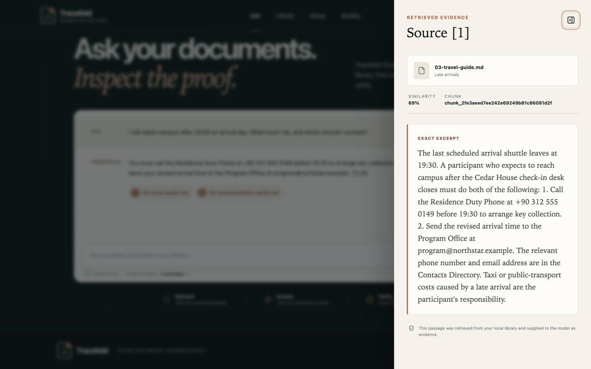

# Tracefold

> **Answers you can trace.** A private, source-grounded document assistant powered entirely by Microsoft Foundry Local.


Tracefold turns a small document library into inspectable answers. It parses and chunks files, creates embeddings on the device, stores Float32 vectors in SQLite, retrieves evidence with cosine similarity, and asks a local chat model to answer only from numbered passages. If the evidence is too weak—or a generated citation cannot be validated—the application refuses instead of guessing.

The result is an assignment-complete local RAG system presented as a polished product: runtime setup, document library, evidence-first chat, citation drawer, deterministic abstention, and a reproducible quality dashboard.

## Product preview



## Why Tracefold

- **Local by design:** documents, embeddings, prompts, and answers stay on the machine.
- **Inspectable evidence:** every displayed citation opens the exact stored passage, section/page, chunk ID, and score.
- **Grounded failure:** unknown or missing citation IDs are rejected; insufficient retrieval returns one standard refusal.
- **Honest evaluation:** eight answerable and four unanswerable cases run against a checked-in synthetic corpus, with targets kept separate from measured results.
- **Presentation ready:** responsive Tracefold branding, a five-minute talk track, architecture/evaluation documentation, and final deck assets.

## Assignment coverage

| Requested capability | Tracefold implementation |
| --- | --- |
| 5–10 source documents | 8 cohesive, synthetic Northstar Summer Lab documents |
| Local embeddings and chat | Foundry Local `qwen3-embedding-0.6b` + `qwen2.5-7b` |
| Document chunking | Heading-aware 240-token chunks with 45-token overlap; sections never merge |
| Vector persistence | Little-endian Float32 embedding BLOBs in SQLite |
| Retrieval | Stable cosine top-k with a per-document diversity cap |
| Grounded answers | Evidence-only prompt, citation-ID validation, exact evidence drawer |
| Safe unknown handling | Calibrated pre-generation threshold plus deterministic refusal |
| Evaluation and testing | 12-case dataset, persisted metrics, 17 automated tests, real-model run |
| Final presentation | Six-slide English deck, PDF export, and Turkish speaker script |

## Requirements

- Python 3.11
- Node.js 20 or newer
- Microsoft Foundry Local supported on the host machine
- Approximately 6 GB of free model storage
- 16 GB unified/system memory recommended for the release chat model
- Network access only for the first dependency/model download

The verified release setup uses WebGPU on an Apple M1 Pro with 16 GB memory. Foundry Local selects a compatible cached variant on other supported machines; set `TRACEFOLD_DEVICE=cpu` or `gpu` only when you need to override automatic selection.

## Quick start

```bash
git clone https://github.com/fufuizm/summer-school-rag-agent.git
cd summer-school-rag-agent

make bootstrap   # Python + frontend dependencies
make models      # one-time Foundry Local model download and smoke test
make seed-reset  # index the 8 synthetic demo documents
make demo        # build UI and bind the complete app to localhost
```

Open [http://127.0.0.1:8000](http://127.0.0.1:8000). After `make models`, the core demo can run with the network disabled.

The `seed-reset` command intentionally replaces only Tracefold's local `data/tracefold.db` and `data/documents/` index. Use `make seed` to add any missing demo documents without resetting an existing index.

Before a judged presentation, run `make demo-ready` once instead of `make seed-reset`. It rebuilds the synthetic corpus and persists a fresh real-model evaluation in the default local database, so **Quality** opens with measured results. This command is intentionally destructive to the current Tracefold demo index and can take several minutes on a cold model load.

## Demo in 90 seconds

1. Open **Setup** and show the exact Foundry Local model variants and device.
2. Open **Library** and confirm eight documents and 53 chunks are indexed locally.
3. Ask:

   ```text
   I will reach campus after 20:00 on arrival day. What must I do, and whom should I contact?
   ```

4. Open the citation drawer to inspect the Travel Guide and Accommodation Guide passages referenced by the validated answer. Those passages contain the required phone and email; the three-source coverage target applies to top-five retrieval, not to the final citation-chip count.
5. Ask the negative case:

   ```text
   How much is the Northstar scholarship stipend?
   ```

6. Open **Quality** and run the checked-in 12-case evaluation.

Expected refusal:

```text
I couldn't find enough evidence in the indexed documents to answer that.
```

## Commands

| Command | Purpose |
| --- | --- |
| `make bootstrap` | Create `.venv`, install Python dependencies, run `npm ci` |
| `make models` | Cache both release models and run embedding/chat smoke checks |
| `make build` | Type-check and create the production frontend bundle |
| `make seed` | Add missing synthetic demo documents to the local index |
| `make seed-reset` | Rebuild the local demo index from scratch |
| `make demo-ready` | Rebuild demo data and persist a fresh 12-case real-model quality run |
| `make demo` | Serve the complete same-origin app at `127.0.0.1:8000` |
| `make api` / `make web` | Run backend and Vite separately for development |
| `make test` | Run deterministic backend tests and frontend production build |
| `make eval` | Run the real 12-case evaluation in isolated `.tracefold-eval/` data |

The deterministic `TRACEFOLD_RUNTIME=fake` adapter is available only for automated tests. The user-facing runtime defaults to Foundry Local and exposes failures; there is no silent production fallback.

## API

| Method | Endpoint | Purpose |
| --- | --- | --- |
| `GET` | `/health` | Service and local index counts |
| `GET` | `/api/runtime` | Exact model, device, cache, load, and execution-provider state |
| `POST` | `/api/documents` | Validate, parse, chunk, embed, and persist one document |
| `GET` | `/api/documents` | List local sources and chunk counts |
| `DELETE` | `/api/documents/{id}` | Delete one document and its chunks |
| `DELETE` | `/api/documents` | Clear the local library |
| `GET` | `/api/jobs/{id}` | Read the persisted ingestion outcome |
| `POST` | `/api/chat` | Return a validated grounded answer as JSON |
| `POST` | `/api/chat/stream` | Return retrieval metadata, then post-validation answer-token and citation SSE events |
| `POST` | `/api/evaluations/run` | Run the built-in or a supplied evaluation set |
| `GET` | `/api/evaluations/latest` | Read the latest persisted quality report |

Document ingestion is intentionally synchronous in this single-user demonstration. A completed/failed job record is still persisted so the UI and API expose durable progress and errors without claiming a background queue.

## Architecture

```text
React + TypeScript UI (same-origin localhost)
            │
         FastAPI
            │
   ┌────────┼───────────┐
   │        │           │
Parser   RAG policy   Evaluator
   │        │           │
   └── SQLite text + Float32 vectors
            │
       Foundry Local
  qwen3 embedding + qwen2.5 chat
```

See [docs/architecture.md](docs/architecture.md), [docs/privacy.md](docs/privacy.md), and [docs/evaluation.md](docs/evaluation.md) for implementation boundaries and acceptance evidence.

## Project map

```text
backend/           FastAPI, Foundry runtime, parsing, RAG, SQLite, evaluation
frontend/          React/TypeScript/Vite Tracefold product UI
demo_docs/         8 synthetic documents safe for public demos
docs/              architecture, evaluation, privacy, demo and talk track
scripts/           model preparation and reproducible demo seeding
tests/             deterministic unit and API contract tests
presentation/      final PPTX/PDF deliverables
```

## Privacy and limitations

Tracefold binds to `127.0.0.1` and does not configure cloud inference, telemetry, web search, authentication, multi-user isolation, OCR, or persistent conversation memory. Image-only PDFs are rejected with an OCR hint. The local SQLite index is tied operationally to the configured embedding model; rebuild the index after changing that model. Treat document content as untrusted—the prompt instructs the model to ignore embedded instructions, but this demo is not a complete adversarial prompt-injection sandbox.

All checked-in Northstar content is fictional. Do not commit private source documents or the generated local database.

## License

[MIT](LICENSE)
