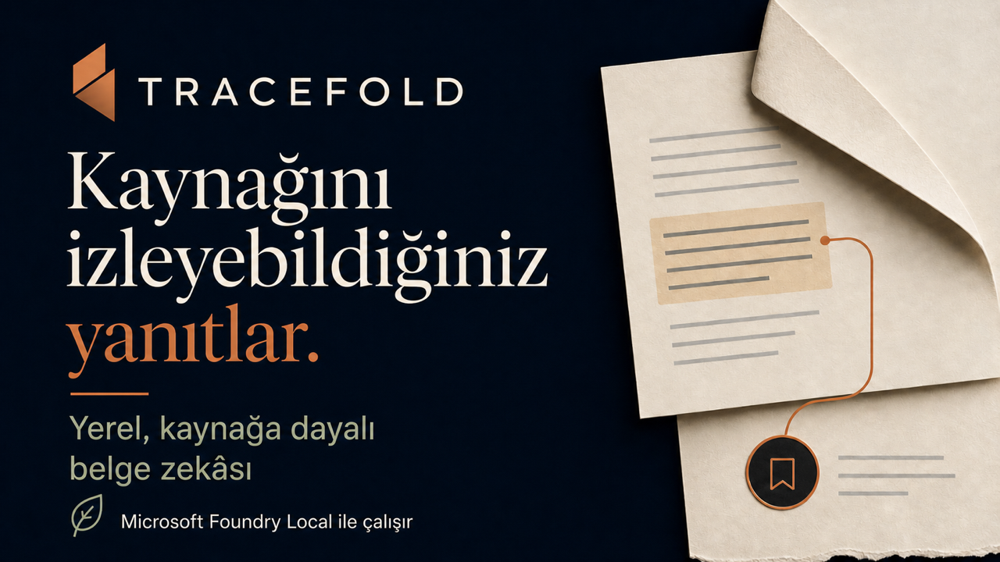

# Tracefold

[English](README.md) · [**Türkçe**](README.tr.md)

> **Kaynağını izleyebildiğiniz yanıtlar.** Microsoft Foundry Local tabanlı, gizlilik odaklı ve kanıta dayalı yerel belge asistanı.



Tracefold, küçük bir belge kütüphanesini incelenebilir İngilizce ve Türkçe yanıtlara dönüştürür. Dosyaları ayrıştırıp bölümlere ayırır, `qwen3-embedding-0.6b` ile cihaz üzerinde gömme vektörleri üretir, Float32 vektörlerini SQLite'ta saklar ve kosinüs benzerliğiyle en ilgili kanıtı bulur. `qwen2.5-14b`, yalnızca bulunan kanıtlara dayanarak İngilizce iddialar oluşturur. Çevrimdışı OPUS-MT katmanı Türkçe soruları İngilizce arama sorgusuna, doğrulanmış İngilizce iddiaları da kontrollü Türkçe yanıtlara dönüştürür.

Kanıt zayıfsa ya da çeviri, kritik değer, dil veya atıf denetimlerinden biri başarısız olursa Tracefold tahmin yürütmez; dile özgü güvenli ret yanıtını verir.

## Ürün görünümü


## Neden Tracefold?

- **Tasarımı gereği yerel:** Normal soru yanıtlama akışında belgeler, vektörler, istemler, ara çeviriler ve yanıtlar cihazdan ayrılmaz.
- **İncelenebilir kanıt:** Her atıf, saklanan pasajı, bölüm/sayfa bilgisini, parça kimliğini ve benzerlik puanını açar.
- **Kanıta dayalı güvenli ret:** Her olgusal cümle geçerli kanıta bağlanır. Kanıt yetersizse sistem uydurmak yerine açıkça yanıt veremediğini söyler.
- **Denetimli iki dilli akış:** Türkçe sorgu, korunan değerlerle çevrilir; İngilizce iddialar doğrulanır; Türkçe çıktı, atıfları yeniden kurulduktan ve geri çeviri, olgu ve dil denetimlerinden geçtikten sonra sunulur.
- **Dürüst değerlendirme:** 12 İngilizce–Türkçe soru çifti, toplam 24 senaryoda ölçülür; 16 senaryo yanıt, 8 senaryo güvenli ret gerektirir.
- **Sunuma hazır teslim:** Farklı ekran boyutlarına uyum sağlayan arayüz, gerçek model raporu, mimari ve gizlilik belgeleri ile İngilizce ve Türkçe PPTX/PDF sunumlar birlikte yayımlanır.

## Ödev kapsamı

| İstenen yetenek | Tracefold uygulaması |
| --- | --- |
| 5–10 kaynak belge | Birbiriyle tutarlı 8 sentetik Northstar Summer Lab belgesi |
| Yerel vektörleştirme ve sohbet | Foundry Local `qwen3-embedding-0.6b` + `qwen2.5-14b` |
| Türkçe desteği | Sabitlenmiş OPUS-MT TR→EN ve EN→TR modelleri, sürümlü sözlük, koruma belirteçleri ve ters çeviri kapısı |
| Belge parçalama | Başlıkları dikkate alan, yaklaşık 240 belirteçten oluşan ve 45 belirteç örtüşen metin parçaları |
| Vektör saklama | SQLite içinde little-endian biçimindeki Float32 BLOB'ları |
| Kanıt bulma | Kararlı kosinüs benzerliğiyle ilk k sonuç ve belge başına çeşitlilik sınırı |
| Kanıta dayalı yanıt | Yalnızca kanıt istemi, cümle düzeyinde atıf doğrulaması, kritik olgu kontrolleri ve açılabilir pasajlar |
| Yanıtlanamayan sorularda güvenli ret | Ölçülmüş eşik ve değişmez İngilizce/Türkçe ret yanıtları |
| Kalite güvencesi | 24 senaryolu iki dilli değerlendirme, lint, birim testleri, kapsam, üretim derlemesi ve tarayıcı E2E testleri |
| Final sunumu | İngilizce ve Türkçe 6 slaytlık PPTX/PDF teslimleri |

## Gereksinimler

- Python 3.11
- Node.js 20 veya üzeri
- Makinede desteklenen Microsoft Foundry Local kurulumu
- Seçilen Foundry model varyantları için yeterli boş alan
- Doğrulanan kurulum için önerilen 16 GB birleşik bellek veya sistem belleği
- Yalnızca ilk bağımlılık ve model indirmesi sırasında ağ bağlantısı

Gerçek-model değerlendirmesi; tam Foundry varyantlarını, yürütme sağlayıcısını, OPUS-MT kimliklerini, yapılandırmayı ve temiz Git revizyonunu [`docs/evaluation-report.json`](docs/evaluation-report.json) içinde kaydeder.

## Hızlı başlangıç

```bash
git clone https://github.com/furkan-sarica/tracefold.git
cd tracefold

make bootstrap   # hash değerleriyle doğrulanan Python ve npm bağımlılıkları + Playwright Chromium
make models      # Foundry + OPUS-MT modellerini bir kez indir ve doğrula
make seed-reset  # 8 sentetik demo belgesini dizine ekle
make demo        # üretim arayüzünü derle ve uygulamayı localhost'ta başlat
```

Ardından [http://127.0.0.1:8000](http://127.0.0.1:8000) adresini açın. Modeller indirildikten sonra soru yanıtlama akışı ağ bağlantısı olmadan çalışabilir.

Python 3.11 bağımlılıkları, depodaki hash değerleriyle doğrulanan `requirements-lock.txt` ve `requirements-dev-lock.txt` dosyalarından; npm bağımlılıkları ise `frontend/package-lock.json` dosyasından kurulur. Elle düzenlenen `requirements*.txt` dosyaları desteklenen sürüm aralıklarını tanımlar. Bu aralıkları değiştirdikten sonra platformdan bağımsız iki Python kilit dosyasını `uv` ile yeniden üretmek için bilinçli olarak `make lock` çalıştırın; oluşan farkı inceleyip test edin.

`make seed-reset`, yalnızca Tracefold'un yerel `data/tracefold.db` veritabanını ve `data/documents/` dizinini yeniden kurar. Mevcut indeksi sıfırlamadan eksik demo belgelerini eklemek için `make seed` kullanın.

Sunumdan önce `make demo-ready` çalıştırın. Bu komut demo indeksini yeniler, 24 senaryolu gerçek model değerlendirmesini çalıştırır, sonucu yerel veritabanına kaydeder ve JSON raporunu dışa aktarır. Mevcut demo verisini bilinçli olarak sıfırladığını unutmayın.

## İki dilli demo akışı

1. **Kurulum** ekranında Foundry varyantlarını, cihazı ve iki OPUS-MT modelinin hazır olduğunu gösterin.
2. **Kütüphane** ekranında 8 belge ve 53 metin parçasının yerel olarak dizine eklendiğini doğrulayın.
3. İngilizce olarak şu soruyu sorun:

   ```text
   I will reach campus after 20:00 on arrival day. What must I do, and whom should I contact?
   ```

4. Atıf çekmecesini açıp yanıtı destekleyen Travel Guide ve Accommodation Guide pasajlarını inceleyin.
5. Arayüzü Türkçeye çevirip eşdeğer soruyu sorun:

   ```text
   Varış günü kampüse saat 20:00'den sonra ulaşacağım. Ne yapmalıyım ve kiminle iletişime geçmeliyim?
   ```

6. `19:30`, `+90 312 555 0149` ve `program@northstar.example` değerlerinin aynen korunduğunu; Türkçe yanıtın aynı yerel kanıta dayandığını gösterin.
7. Belgelerde bulunmayan bir bilgiyi sorun:

   ```text
   Northstar bursunun tutarı ne kadar?
   ```

   Beklenen güvenli ret:

   ```text
   Kütüphanenizde bu soruyu yanıtlamak için yeterli kanıt bulamadım.
   ```

8. **Kalite** ekranında 24 senaryolu raporu, dil kırılımını, temiz Git kaydını ve ayrıntılı Türkçe dil incelemesini açın.

## Komutlar

| Komut | Amaç |
| --- | --- |
| `make bootstrap` | Sanal ortamı oluşturur, hash değerleriyle doğrulanan Python ve npm bağımlılıklarını kurar ve Playwright Chromium'u indirir |
| `make lock` | Python 3.11 için platformdan bağımsız, hash değerleriyle doğrulanan çalışma zamanı ve geliştirme kilit dosyalarını `uv` ile yeniler |
| `make frontend-browser` | Playwright kilidinin belirlediği Chromium sürümünü indirir |
| `make models` | İki Foundry ve iki OPUS-MT modelini önbelleğe alıp temel yerel çalışırlık denetimlerini yürütür |
| `make build` | TypeScript denetimini ve üretim arayüz derlemesini çalıştırır |
| `make seed` | Eksik sentetik belgeleri yerel dizine ekler |
| `make seed-reset` | Yerel demo dizinini baştan kurar |
| `make demo-ready` | Demo verisini, gerçek model değerlendirmesini, veritabanını ve JSON raporunu birlikte yeniler |
| `make demo` | Uygulamayı `127.0.0.1:8000` üzerinde sunar |
| `make lint` | Ruff ve ESLint kontrollerini uyarı kabul etmeden çalıştırır |
| `make test` | Arka uç ve arayüz birim testlerini, kapsam ölçümünü ve üretim derlemesini çalıştırır |
| `make test-e2e` | Masaüstü ve mobil Playwright akışlarını çalıştırır |
| `make release-check` | Kilitli Python geliştirme bağımlılıklarını ve tüm npm bağımlılıklarını güvenlik açısından tarar; lint denetimini, birim testlerini, kapsam ölçümünü, üretim derlemesini ve tarayıcı E2E kapılarını çalıştırır |
| `make eval` | Yalıtılmış dizinde 24 senaryolu gerçek model değerlendirmesini üretir |
| `make release-checksums` | Son raporu ve İngilizce/Türkçe sunumları doğrulayıp `release/SHA256SUMS` dosyasını atomik olarak oluşturur |
| `make release-artifacts` | Temiz Git kaydını, rapor onayını, sunum/PDF yapısını ve tüm yayın sağlama toplamlarını doğrular |
| `make release-ready` | Deterministik yayın kapılarıyla salt okunur son varlık denetimini birlikte çalıştırır |

Testlerdeki `TRACEFOLD_RUNTIME=fake` bağdaştırıcısı yalnızca deterministik sözleşme testleri içindir. Gerçek kullanıcı akışı Foundry Local kullanır; üretimde sessizce devreye giren bir yedek çalışma yolu yoktur.

GitHub Actions; Python ve arayüz kalite kapılarını, geliştirme bağımlılıklarının güvenlik taramasını ve son sürüm varlıklarının bütünlük denetimini ana dala yapılan gönderimlerde ve tüm pull request'lerde tekrarlar. `make release-check`, rapor ve sunumlar henüz hazırlanmadan da deterministik kod kapılarını çalıştırabilmek için varlık denetimini içermez; eksiksiz son denetim `make release-ready` komutudur. Gerçek model değerlendirmesi Foundry Local ve indirilmiş modeller gerektirdiği için bilinçli bir yerel yayın adımıdır. Bir rapor ancak hedef Git commit'ini kaydediyor ve `dirty: false` içeriyorsa yayın kanıtı sayılır.

Yayın için önce davranış adayını ayrı bir Git commit'i olarak kaydedin ve temiz revizyonda `make eval` çalıştırın. Yazdırılan tüm Türkçe senaryoları okuduktan sonra onayı `scripts/review_evaluation.py --report-json docs/evaluation-report.json --data-dir .tracefold-eval --reviewer "<inceleyen>" --approve` komutuyla kaydedin. Son İngilizce/Türkçe PPTX ve PDF dosyaları dışa aktarıldıktan sonra `make release-checksums` çalıştırın, yalnızca kanıt ve varlık değişikliklerini ayrı bir commit'te kaydedin ve temiz son commit'te `make release-ready` ile doğrulayın. Sürüm dosyaları denetimi, değerlendirilen davranış revizyonunun son commit'in atası olmasını zorunlu tutar ve araya giren çalışma kodu değişikliklerini reddeder.

## Mimari

```text
React + TypeScript (localhost'ta aynı kökenden sunulur)
               │
            FastAPI
               │
      ┌────────┼──────────┐
      │        │          │
 Ayrıştırıcı  RAG ilkesi  Değerlendirici
      │        │          │
      └── SQLite metin + Float32 vektörler
               │
       Foundry Local RAG çekirdeği
    qwen3 embedding + qwen2.5 chat
               │
       Yerel OPUS-MT TR↔EN kontrolü
```

Ayrıntılar için [mimari](docs/architecture.md), [gizlilik](docs/privacy.md) ve [değerlendirme](docs/evaluation.md) belgelerine bakın.

## Gizlilik ve sınırlar

Tracefold `127.0.0.1` adresine bağlanır; bulut çıkarımı, web araması, çok kullanıcılı yalıtım, OCR veya kalıcı sohbet geçmişi yapılandırmaz. Yalnızca görsel içeren PDF'ler, OCR gerektiği belirtilerek reddedilir. SQLite dizini kullanılan vektörleştirme modeline operasyonel olarak bağlıdır; vektörleştirme modeli değiştiğinde dizini yeniden kurun.

Atıflar denetlenebilirliği artırır ancak uygulamayı tıbbi, hukuki, acil durum veya gerçek zamanlı bilgi hizmetine dönüştürmez. Sürümlü sözlük Northstar demo alanına yöneliktir; yeni bir uzmanlık alanı kendi terim incelemesini ve iki dilli değerlendirmesini gerektirir.

Depodaki tüm Northstar içerikleri kurgusaldır. Özel kaynak belgeleri veya üretilen yerel veritabanını Git'e eklemeyin.

## Lisans

Tracefold kaynak kodu [MIT lisanslıdır](LICENSE). Foundry/Qwen ve OPUS-MT varlıkları kendi lisans ve atıf koşullarını korur; ayrıntılar için [üçüncü taraf bildirimlerine](THIRD_PARTY_NOTICES.md) bakın.
