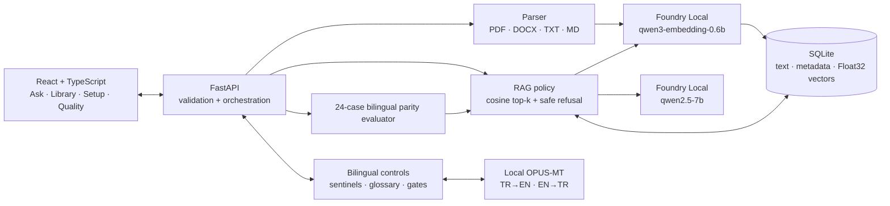
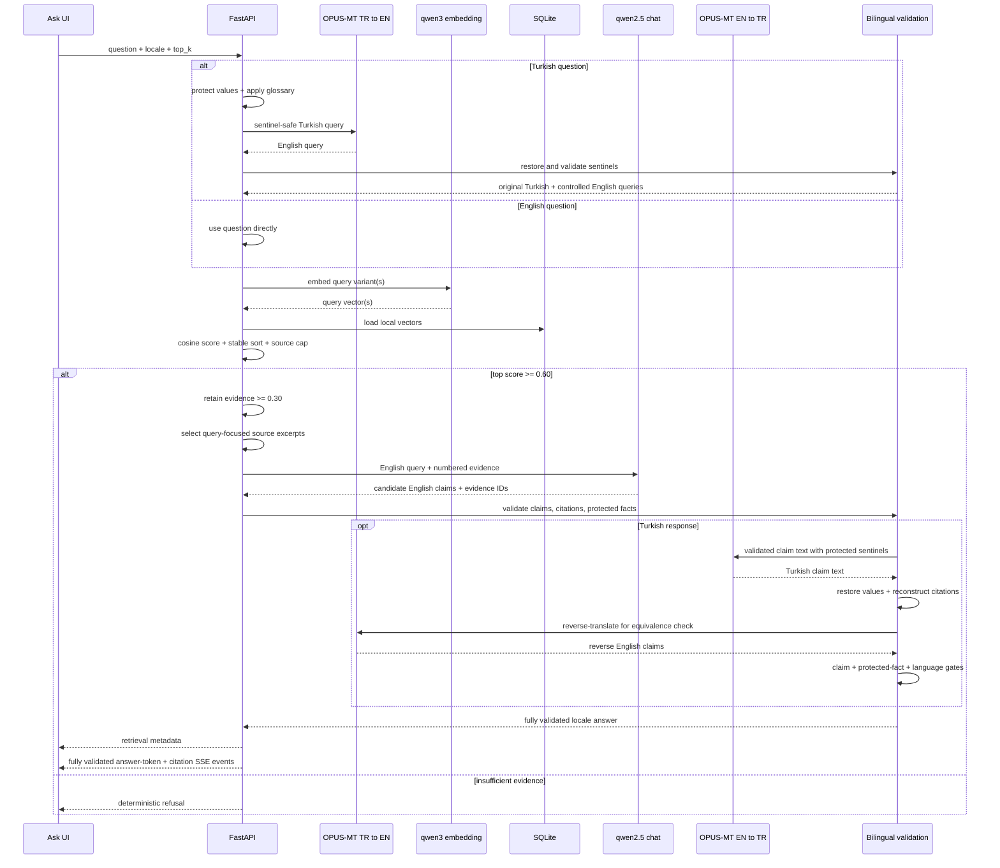

# Tracefold Architecture

## System boundary

Tracefold is a single-user, localhost application. React and FastAPI run on the device; source files and SQLite remain under the selected local data directory. Retrieval embeddings and grounded English claim generation run through Microsoft Foundry Local. A separate, controlled OPUS-MT layer performs Turkish↔English translation locally. There is no hosted inference path, API key, cloud sync, web search, or silent production fallback.

The production-style local run serves the compiled frontend and API from `127.0.0.1:8000`, so the UI has no external asset or cross-origin dependency. Development mode may run Vite separately on `127.0.0.1:5173`.

## Foundry Local runtime

The runtime adapter owns all SDK-specific behavior:

- initializes the `tracefold` Foundry Local application cache;
- discovers and, when necessary, re-registers WebGPU for the current process;
- selects a cached compatible GPU/CPU model variant;
- exposes the exact alias, variant ID, device, execution provider, cache, load, and error state;
- loads both configured models before inference and uses deterministic chat settings;
- raises an actionable `503` when the real local runtime is unavailable.

Release aliases are `qwen3-embedding-0.6b` for retrieval and `qwen2.5-7b` for grounded claim generation. Their resolved Foundry variant IDs, device, and execution provider belong to the run; they are visible in **Setup** and recorded in `docs/evaluation-report.json`.

`TRACEFOLD_RUNTIME=fake` is an explicit deterministic test adapter. It is never selected automatically by the user-facing application.

## Controlled offline translation layer

Tracefold uses two dedicated Helsinki-NLP OPUS-MT checkpoints outside the Foundry chat path:

- `Helsinki-NLP/opus-mt-tc-big-tr-en` for a Turkish question to an English retrieval/generation query;
- `Helsinki-NLP/opus-mt-tc-big-en-tr` for a validated English claim to the displayed Turkish answer.

The models are downloaded during explicit setup and run on the host. Query text is not sent to Hugging Face or another hosted inference service. The checkpoints are CC BY 4.0; attribution and upstream links are in [`THIRD_PARTY_NOTICES.md`](../THIRD_PARTY_NOTICES.md).

Translation is a controlled stage, not an instruction given to `qwen2.5-7b`:

1. mask dates, times, numbers, phone numbers, email addresses, and glossary-controlled terms with typed sentinels;
2. apply the checked-in, extensible Northstar glossary around translation so approved product/corpus terms remain stable;
3. translate the Turkish question to English with the TR→EN model, restore protected values, and reject missing, duplicated, or altered sentinels;
4. retain the original Turkish query alongside the accepted English translation, retrieve source evidence with `qwen3-embedding-0.6b`, then have `qwen2.5-7b` produce concise English claims with evidence IDs;
5. validate the English claims and citations before any answer translation;
6. detach and map citation IDs, protect critical values again, translate only the validated claim text with the EN→TR model, then reconstruct citations on the corresponding Turkish sentence or list item;
7. reverse-translate the Turkish output, compare its protected facts and claims with the validated English intermediate, and apply Turkish-language quality gates;
8. emit the Turkish answer only if every required gate passes; otherwise return the exact Turkish safe refusal.

The glossary is intentionally narrow and reviewable. It covers Tracefold product language and terminology needed by the synthetic Northstar release corpus, and its format can accept additional domain entries. It is not a universal terminology database. The OPUS-MT checkpoints have broader translation capability, but the release claim is limited to the checked-in corpus and the 24-case parity evaluation; a different corpus needs glossary review and its own bilingual tests.

## Ingestion

`POST /api/documents` is intentionally synchronous for this single-user demonstration:

1. validate the extension, filename, 25 MB size limit, and non-empty payload;
2. compute SHA-256 and reject an already indexed document;
3. extract text while retaining page or Markdown/DOCX heading metadata;
4. split into approximately 240-token chunks with 45-token overlap;
5. keep heading sections isolated—content from adjacent sections is never merged;
6. create embeddings through Foundry Local;
7. persist the document and every chunk in one SQLite transaction;
8. persist a completed or failed job record and return its ID.

The UI can read the durable job outcome, but Tracefold does not claim a background queue. Supported formats are text-based PDF, DOCX, TXT, Markdown, and `.markdown`. Image-only PDFs are rejected with a clear OCR hint.

## Storage

SQLite tables:

- `documents`: filename, checksum, media type, size, status, timestamps, and chunk count;
- `chunks`: document ID, stable ordinal, text, source location, section, token count, vector dimension, and vector BLOB;
- `ingestion_jobs`: state, normalized progress, message/error, and timestamps;
- `evaluation_runs`: aggregate metrics, per-case evidence, answers, and run context.

Embeddings are serialized as little-endian Float32 values. Reads verify the stored byte length against the vector dimension before cosine scoring. Foreign-key cascade removes chunks when a document is deleted.

The schema does not migrate vectors between embedding models. Rebuild the index after changing `TRACEFOLD_EMBEDDING_MODEL`; the README and privacy documentation make this operational boundary explicit.

## Retrieval and answer policy

Retrieval ranks all stored chunks with `qwen3-embedding-0.6b` cosine similarity and a stable filename/ordinal/ID tie-break. A configurable cap (release value: two) prevents one long document from filling the entire top-k while still allowing complementary passages from the same source. English questions use one query vector. After the sentinel checks pass, Turkish retrieval keeps the original multilingual query and adds the controlled TR→EN translation; each chunk receives the best score across those variants. A lossy/rejected translation fails closed with the deterministic Turkish safe refusal rather than asking the chat model to translate or silently changing paths. Missing translation assets produce a visible setup/runtime error.

The release configuration uses a `0.60` pre-generation threshold and a `0.30` evidence floor after section-isolated chunking. Once the gate passes, passages at or above the evidence floor may be supplied to the chat model. The accepted real-model report is the authority for whether that calibration separates answerable and unanswerable cases; model, corpus, chunking, or retrieval changes require a fresh evaluation rather than assuming the threshold still holds.

To stay within a reliable local-model context budget, Tracefold selects a question-focused excerpt from each retrieved chunk. The `qwen2.5-7b` prompt treats documents as untrusted data, requests complete multi-step procedures, limits filler, and requires numbered evidence IDs on English claims. Unknown, missing, or out-of-range citations trigger one constrained grounded repair; a second failure becomes the locale-specific deterministic refusal.

Validation is layered around generation and translation. Every English factual sentence or list item must end with one or more valid evidence IDs, and protected values such as dates, times, numbers, phone numbers, and email addresses must appear in cited evidence. For Turkish, citations are reconstructed from the validated English sentence map rather than generated or translated as free text. Exact sentinel restoration, reverse-translation equivalence, protected-fact grounding, and Turkish-language quality must all pass. Failure at any required layer produces the locale-specific safe refusal instead of an unchecked response.

For safety, the SSE endpoint emits answer tokens only after the complete answer passes citation validation. It is a validated event stream, not raw model-token passthrough.

## Evaluation

The evaluator warms the Foundry and translation runtimes, runs dataset `northstar-summer-lab-2026-bilingual-parity-v3`, persists all answers and cited/retrieved sources, and exports the same result as `docs/evaluation-report.json`. Its 24 cases contain 12 English cases and 12 one-to-one Turkish equivalents: each language has eight answerable cases and four cases that must be safely refused. All 12 unique pairs contribute to the cross-language consistency metric as well as the per-locale results.

Each run records:

- exact Foundry and OPUS-MT model/runtime/device information;
- platform, retrieval, translation, sentinel, and glossary configuration;
- document/chunk counts;
- Hit@5, source recall, citation validity/source precision, and sentence-level citation coverage;
- protected-fact grounding, required-fact recall, snippet token recall, reverse-translation equivalence, and Turkish language-quality checks;
- negative refusal accuracy, per-locale breakdowns, and bilingual paired-case accuracy;
- warm retrieval timing and separate model warm-up cost.

The run context also contains the dataset ID, document/chunk counts, retrieval/translation settings, glossary identity, exact Git revision, dirty-tree flag, and provenance source. A release report is valid only when it identifies the intended code commit and records a clean working tree. The JSON report is evidence, not a substitute for rerunning the real models after code, corpus, model, glossary, or retrieval changes.

See [evaluation.md](evaluation.md) for the measured release snapshot and limits of automated scoring.

## Release quality gates

The deterministic gates run without model downloads:

- Ruff and ESLint linting;
- backend unit/API tests with a 75% coverage floor, including sentinel restoration, glossary behavior, citation reconstruction, fail-closed translation rejection, and unavailable-model errors;
- frontend component/unit tests;
- TypeScript checking and the production Vite build;
- Playwright browser E2E coverage of the principal English and Turkish product paths.

`make release-check` runs those local gates, and GitHub Actions repeats them on pushes and pull requests. `make eval` is the separate real-model release gate: it rebuilds an isolated synthetic index, runs all 24 paired cases through the Foundry + OPUS-MT path, persists the result, and writes the reviewable JSON report.

## Privacy and threat boundary

- The application binds to localhost and has no authentication or multi-user isolation.
- Normal chat questions and answers are not written to an application chat history or intentionally included in logs. Evaluation case answers and evidence are deliberately persisted in `evaluation_runs` for reproducibility.
- Uploaded files and SQLite are ignored by version control.
- Source text is treated as untrusted in the grounding prompt, but this educational demo is not a complete adversarial prompt-injection sandbox.
- The OPUS-MT checkpoints run locally after explicit download; query-time translation does not call a hosted service.
- There is no OCR, telemetry, remote backup, persistent chat memory, or agentic external action.

See [privacy.md](privacy.md) for the user-facing data lifecycle.
