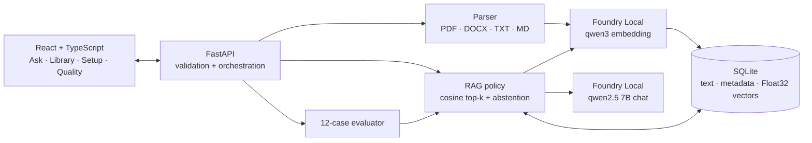
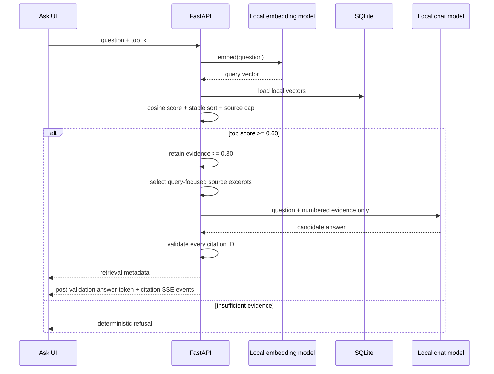

# Tracefold Architecture

## System boundary

Tracefold is a single-user, localhost application. React and FastAPI run on the device; source files and SQLite remain under the selected local data directory; embeddings and answer generation run through Microsoft Foundry Local. There is no hosted inference path, API key, cloud sync, web search, or silent production fallback.

The production-style local run serves the compiled frontend and API from `127.0.0.1:8000`, so the UI has no external asset or cross-origin dependency. Development mode may run Vite separately on `127.0.0.1:5173`.

## Foundry Local runtime

The runtime adapter owns all SDK-specific behavior:

- initializes the `tracefold` Foundry Local application cache;
- discovers and, when necessary, re-registers WebGPU for the current process;
- selects a cached compatible GPU/CPU model variant;
- exposes the exact alias, variant ID, device, execution provider, cache, load, and error state;
- loads both models before inference and uses deterministic chat settings;
- raises an actionable `503` when the real local runtime is unavailable.

Release aliases:

- embedding: `qwen3-embedding-0.6b`;
- chat: `qwen2.5-7b`.

`TRACEFOLD_RUNTIME=fake` is an explicit deterministic test adapter. It is never selected automatically by the user-facing application.

## Ingestion

`POST /api/documents` is intentionally synchronous for this single-user demonstration:

1. validate the extension, filename, 25 MB size limit, and non-empty payload;
2. compute SHA-256 and reject an already indexed document;
3. extract text while retaining page or Markdown/DOCX heading metadata;
4. split into approximately 240-token chunks with 45-token overlap;
5. keep heading sections isolated—content from adjacent sections is never merged;
6. create embeddings through Foundry Local;
7. persist the document and every chunk in one SQLite transaction;
8. persist a completed or failed job record and return its ID.

The UI can read the durable job outcome, but Tracefold does not claim a background queue. Supported formats are text-based PDF, DOCX, TXT, Markdown, and `.markdown`. Image-only PDFs are rejected with a clear OCR hint.

## Storage

SQLite tables:

- `documents`: filename, checksum, media type, size, status, timestamps, and chunk count;
- `chunks`: document ID, stable ordinal, text, source location, section, token count, vector dimension, and vector BLOB;
- `ingestion_jobs`: state, normalized progress, message/error, and timestamps;
- `evaluation_runs`: aggregate metrics, per-case evidence, answers, and run context.

Embeddings are serialized as little-endian Float32 values. Reads verify the stored byte length against the vector dimension before cosine scoring. Foreign-key cascade removes chunks when a document is deleted.

The schema does not migrate vectors between embedding models. Rebuild the index after changing `TRACEFOLD_EMBEDDING_MODEL`; the README and privacy documentation make this operational boundary explicit.

## Retrieval and answer policy

Retrieval ranks all stored chunks with cosine similarity and a stable filename/ordinal/ID tie-break. A configurable cap (release value: two) prevents one long document from filling the entire top-k while still allowing complementary passages from the same source.

The `0.60` pre-generation threshold was calibrated on the checked-in real-model dataset after section-isolated chunking. Answerable cases had a minimum top score above the negative cases; all four negative cases remain below the selected gate. Once the gate passes, passages scoring at least `0.30` may be supplied as evidence.

To stay within a reliable local-model context budget, Tracefold selects a question-focused excerpt from each retrieved chunk. The prompt treats documents as untrusted data, requests complete multi-step procedures, limits filler, and requires numbered evidence IDs. Unknown, missing, or out-of-range citations trigger one constrained model repair; a second failure becomes the standard deterministic refusal.

For safety, the SSE endpoint emits answer tokens only after the complete answer passes citation validation. It is a validated event stream, not raw model-token passthrough.

## Evaluation

The evaluator warms the local runtime, runs the checked-in 12 cases, persists all answers and cited/retrieved sources, and records:

- exact runtime/model/device information;
- platform and retrieval configuration;
- document/chunk counts;
- Hit@5, source recall, citation validity/source precision;
- required-fact and snippet token recall;
- negative refusal accuracy;
- warm retrieval timing and separate model warm-up cost.

See [evaluation.md](evaluation.md) for the measured release snapshot and limits of automated scoring.

## Privacy and threat boundary

- The application binds to localhost and has no authentication or multi-user isolation.
- Normal chat questions and answers are not written to an application chat history or intentionally included in logs. Evaluation case answers and evidence are deliberately persisted in `evaluation_runs` for reproducibility.
- Uploaded files and SQLite are ignored by version control.
- Source text is treated as untrusted in the grounding prompt, but this educational demo is not a complete adversarial prompt-injection sandbox.
- There is no OCR, telemetry, remote backup, persistent chat memory, or agentic external action.

See [privacy.md](privacy.md) for the user-facing data lifecycle.
